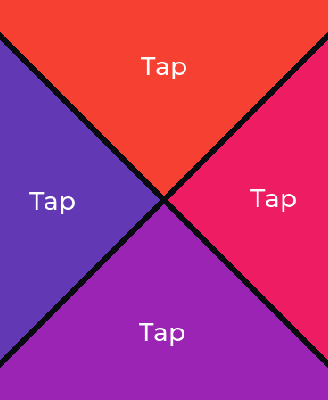
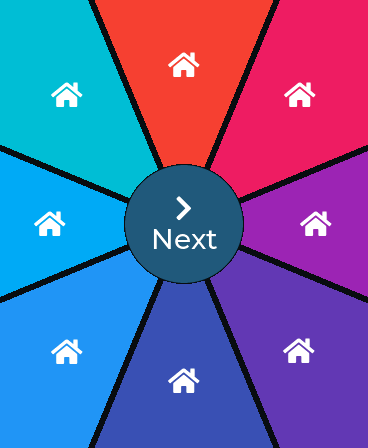

# PieMenuS3

Pie-menu buttons built as custom LVGL 9.6 objects, ported to the
**Waveshare ESP32-S3-Touch-AMOLED-1.8 V2** (368 x 448 CO5300 AMOLED, CST816T
touch), the same board as WaveshareHelloWorld and wireframe_cube. The original
round-screen ESP32-C3 version stays in `..\PieMenu`. Other projects only need
lv_piemenu.h and lv_piemenu.cpp.

On this rectangular screen the demo turns on fill mode: wedges run all the way
to the screen edges and corners, so every pixel belongs to a slice.




## Run

```powershell
.\Build.ps1
.\Build.ps1 -Upload -Port COM5
```

The default is ESP32-S3, 16 MB flash, OPI PSRAM, USB CDC, V2 panel, COM5. Use
`-Revision original` for the original SH8601 panel. `-DryRun` prints the command
without compiling or flashing. Upload replaces the board's existing sketch;
close Serial Monitor first.

Dependencies: LVGL 9.6 from `..\Libraries\lvgl`, plus the display, expander and
pin-definition libraries from `..\WaveshareHelloWorld\vendor\<revision>\libraries`
(GFX_Library_for_Arduino, Adafruit_XCA9554, Adafruit_BusIO, Mylibrary). Each is
passed individually so the vendor folder's LVGL 8.4 is never picked up.

The demo starts with four full-pie slices. Tap Next (or the arrow) to cycle
through two to eight slices. Ring pages have a center Next button. The first
slice toggles its checked state; the penultimate slice is disabled on pages
with six or more slices. Other slices log clicks to USB Serial at 115200 baud.

Serial commands: `n` next, `p` previous, `2` through `8` slice count, `r` switch
ring/pie, `a` toggle the eight-second tour. Without a detected touch controller,
the tour starts automatically. With touch, it waits for you.

Demo tuning lives at the top of `PieMenuS3.ino`: Montserrat 28 labels, 8-pixel
gaps, and a 60-pixel center button.

## API example

```cpp
#include "lv_piemenu.h"

static void lights_clicked(lv_event_t *event) {
    // The event target is the slice, just as with an LVGL button.
}

lv_obj_t *menu = lv_piemenu_create(lv_screen_active()); // fills its parent
lv_piemenu_set_fill(menu, true);     // wedges reach the rectangle's corners
lv_piemenu_set_rotation(menu, -135); // first of four slices centered at top
lv_piemenu_set_gap(menu, 8);         // separator width in pixels; zero fills gaps

lv_obj_t *lights = lv_piemenu_add_button(menu);
lv_piemenu_button_set_text(lights, "Lights");
lv_obj_add_event_cb(lights, lights_clicked, LV_EVENT_CLICKED, nullptr);
lv_obj_set_style_bg_color(lights, lv_color_hex(0x185B82), LV_PART_MAIN);
lv_obj_set_style_bg_color(lights, lv_color_hex(0x428BAC), LV_STATE_PRESSED);

// Add three more slices. Angles and labels reflow automatically.
for (const char *text : {LV_SYMBOL_AUDIO, LV_SYMBOL_SETTINGS, "Back"}) {
    lv_piemenu_button_set_text(lv_piemenu_add_button(menu), text);
}

lv_piemenu_set_inner_radius(menu, 60); // pixels; zero returns to full pie
lv_obj_t *home = lv_piemenu_get_center_button(menu);
lv_piemenu_button_set_text(home, LV_SYMBOL_HOME);
```

- Angles increase clockwise from the right. Default starting angle: -90 degrees.
- Up to eight equal slices. Adding a ninth returns nullptr. Use two to eight
  for practical menus; a single slice is supported while constructing a menu.
- The menu defaults to 100% of its parent. Keep menu padding at zero and let
  the widget control slice position and size.
- Fill off (default): slices end at the circle fitting the smaller dimension,
  for round screens. Fill on: slices extend to the menu's rectangular edges
  and corners, taps anywhere in that area count, and each label sits at its
  clipped slice's area center. On a tall screen the top and bottom slices are
  larger than the side ones.
- Inner radius is clamped to 70% of the inscribed circle's radius. The center
  button stays circular in both modes. Zero hides and retains the center
  object; getting it before first creating a ring returns nullptr. Deleting the
  center clears its stored pointer.
- Separator edges are parallel, with a constant width in pixels (default 6),
  continuing to the screen edge in fill mode. Excessive widths are clamped so
  the central inset stays within 20% of the inscribed radius. Gaps and the
  center hole do not activate a slice; round-mode corners do not either. The
  center has a one-pixel inset for separation.
- `lv_obj_set_checkable(button, true)` enables standard toggling;
  `lv_obj_add_state(button, LV_STATE_DISABLED)` disables input.
- Colors, background opacity, text colors, fonts, and state selectors follow
  LVGL conventions. `lv_piemenu_button_get_label()` exposes the label for
  additional label formatting. Text and LVGL symbol icons are supported;
  keep labels short enough to fit. Bitmap icon placement is not automated.
- The menu installs its own LVGL layout. Setters take effect at the next
  `lv_obj_update_layout()` or display refresh, so call that first if you
  read slice or label coordinates right after changing the menu. Don't set
  another layout (flex or grid) on the menu.
- Delete slices or the menu with `lv_obj_delete()`. Slice angles reflow on
  add/delete and labels reflow on resize. Avoid reparenting slices or deleting
  their internal labels; they belong to their menu.
- Curved fills replace LVGL's rectangular background rendering. Rectangle
  borders, shadows, gradients, and corner-radius styles are not implemented
  for sectors. The rasterizer has pixel-aligned, non-antialiased edges.
- The implementation uses LVGL private class definitions and is tested against
  the workspace's 9.6.0 library. Recheck it when changing LVGL versions.

## Board notes

- Display: CO5300 over QSPI (CS 12, clock 11, data 4-7), reset through the
  XCA9554 expander at 0x20, as in wireframe_cube. The panel needs even-aligned
  redraw windows; an `LV_EVENT_INVALIDATE_AREA` handler rounds them.
- LVGL renders 40-row partial buffers (29 KB) pushed with a blocking transfer.
  The buffer must be aligned to `LV_DRAW_BUF_ALIGN`: LVGL silently rejects a
  misaligned one and never renders, leaving the panel blank. A full frame
  takes about 180-220 ms (43 ms of it the QSPI push). Each slice object spans
  only its bounding box, so a press or release redraws 65-106 ms.
- Touch: CST816T at 0x15 on I2C SDA 15 / SCL 14, read directly over Wire. Its
  registers match the C3 board's touch controller.

## Desktop verification

`Test.ps1` requires the installed CMake and MinGW tools. It builds against the
actual workspace LVGL sources with the same 96 KB LVGL pool as the device on a
368 x 448 display. Build outputs and PPM screenshots go to the temporary
PieMenuS3-host-build folder.

Round-mode tests use a 240 x 240 menu and cover every slice count in both
layouts, real LVGL pointer input, state changes, gaps/corners, label positions,
resizing, slice replacement, and center deletion/recreation. Fill-mode tests
use the full screen and check that each screen corner belongs to exactly one
slice and is painted in its color, slices reach the screen edge, separators stay
empty past the inscribed circle, labels sit inside their slices, the ring hole
and center button own the middle, and a corner tap clicks. Every case repeats
three times with no accumulating heap allocations. PNG previews in `previews`
were converted from the fill-mode LVGL renderings.

After uploading, run `.\Check-Device.ps1` to exercise all seven pages over
USB Serial and leave the four-slice demo ready for touch. This checks firmware
responses; physical touch accuracy and the panel's appearance still need a
hands-on review.
