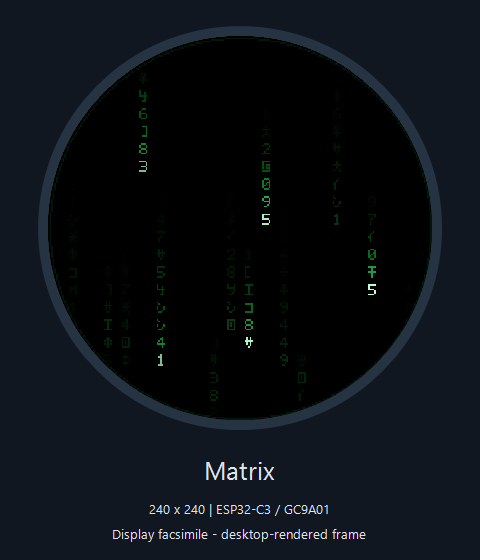
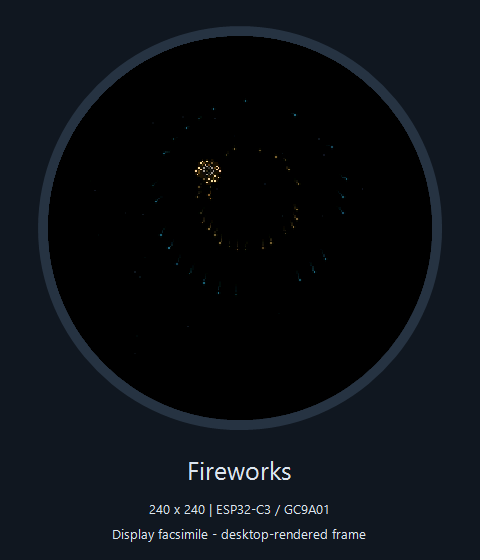
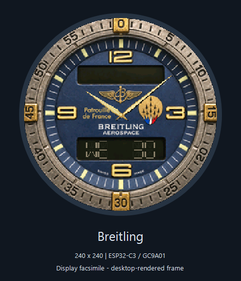
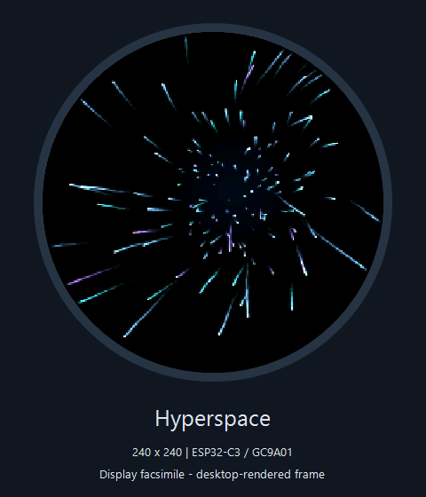
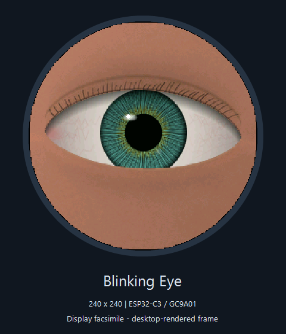
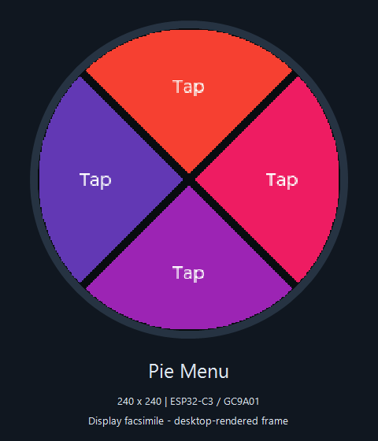
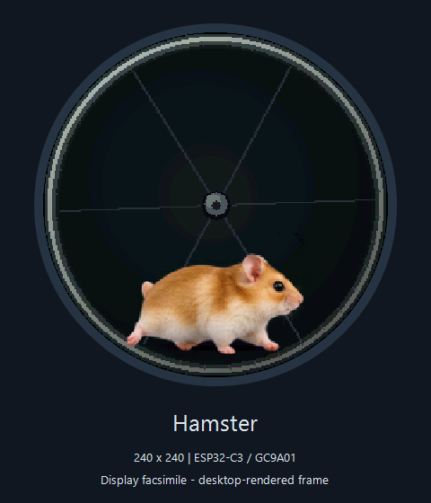
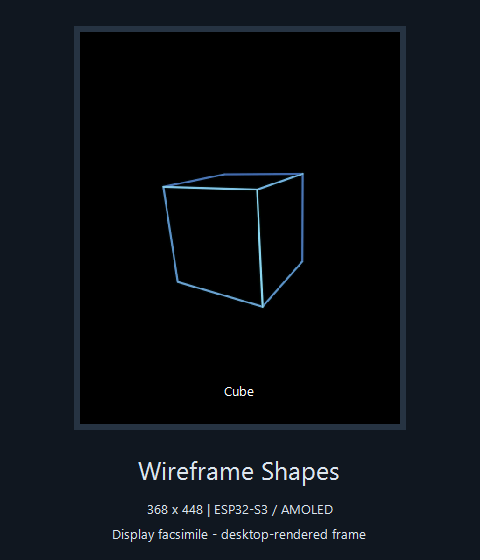

# Arduino display projects

A collection of ESP32 sketches for small displays: animated graphics, watch
faces, touchscreen tools, and hardware experiments. Each project is a separate
firmware application. Uploading one replaces the sketch currently on that board.

Most visual projects use an **ESP32-C3 with a round 240 × 240 GC9A01 display**.
The Waveshare projects use the **ESP32-S3-Touch-AMOLED-1.8 V2**, with a
368 × 448 CO5300 AMOLED. Check each project's configuration before building.

## Display gallery

These facsimiles use the projects' existing desktop-rendered preview frames.
The border is a schematic screen outline, not a photograph or an
enclosure design. Animation, physical brightness, and refresh behavior vary on
hardware; these images show representative still frames.

| Matrix code rain | Fireworks |
| --- | --- |
| [](Matrix/README.md) | [](Fireworks/README.md) |
| Breitling watch face | Hyperspace star tunnel |
| [](Breitling/README.md) | [](Hyperspace/README.md) |
| Blinking eye | Pie menu |
| [](BlinkingEye/README.md) | [](PieMenu/README.md) |
| Hamster wheel | Wireframe shapes |
| [](Hamster/README.md) | [](wireframe_cube/README.md) |

Recreate these images on Windows with `./docs/Generate-DisplayFacsimiles.ps1`.
It reads each project's `preview.png` (or PieMenu's `previews/preview-4-pie.png`),
preserves the original, and writes the
framed facsimiles to `docs/images/`. Project-local preview scripts can regenerate
the underlying frames from the renderers.

## Projects

| Project | Display or behavior |
| --- | --- |
| [wireframe_cube](wireframe_cube/README.md) | Six rotating polyhedra on the S3 AMOLED; 20-second shape cycle, white labels, optional compile-time hidden-line removal. |
| [Matrix](Matrix/README.md) | Green code rain with bright stream heads and fading trails. |
| [Fireworks](Fireworks/README.md) | Rockets, colorful bursts, sparks, and fading trails. |
| [Hyperspace](Hyperspace/README.md) | Curved star streaks in a moving tunnel. |
| [SpinningDisc](SpinningDisc/README.md) | Animated optical spiral with changing colors and motion. |
| [BlinkingEye](BlinkingEye/README.md) | Procedural iris, gaze changes, and blinking eyelids. |
| [Hamster](Hamster/README.md) | Animated hamster running in a wheel. |
| [Radar](Radar/README.md) | Green phosphor-style radar with simulated contacts; LVGL. |
| [WatchFace](WatchFace/README.md) | Purple digital watch face with a preset starting time and sample heart-rate value. |
| [WatchFaceRTC](WatchFaceRTC/README.md) | Network-synchronized version of the digital watch face. |
| [Breitling](Breitling/README.md) | Aerospace-inspired analog dial and weekday/date LCD. |
| [Rolex](Rolex/README.md) | Analog watch-face project. |
| [CoinFlip](CoinFlip/README.md) | Touch-triggered animated gold coin toss. |
| [Dice](Dice/README.md) | Touch menu for tabletop dice and a gold coin. |
| [PieMenu](PieMenu/README.md) | Custom LVGL radial buttons and touchscreen menu examples. |
| [LVGL_Demo](LVGL_Demo/README.md) | LVGL 9 widget gallery for the round touch display. |
| [HelloScreen](HelloScreen/README.md), [HelloScreenHD](HelloScreenHD/README.md) | Display greetings and uptime; HD variant uses larger fonts. |
| [WaveshareHelloWorld](WaveshareHelloWorld/README.md) | S3 swipeable hardware tests: touch, sensors, audio, networking, storage, and clock. |
| [wtxt](wtxt/README.md) | Network text-message display and PowerShell client. |

The numbered folders contain factory, UART, LVGL benchmark/widgets, Wi-Fi,
TCP/UDP, and BLE examples. Other small sketches include `hello_world_serial`,
`serial_out_1`, `s7s_counter`, `Helloworld`, and dated experiments.
`Libraries/` contains local library sources; `docs/` also contains board
documentation and supplied utilities. Those folders are not standalone sketches.

## Build and upload

Use Arduino IDE or the project's PowerShell build script with Arduino CLI and
the Espressif ESP32 board package installed. Scripts may contain machine-local
CLI/config paths; inspect their parameters when setting up another computer.
There is no single build command for every project.

For the S3 polyhedron animation, from the repository root:

```powershell
./wireframe_cube/Build.ps1
./wireframe_cube/Build.ps1 -Upload -Port COM5
```

For a round-display project, for example:

```powershell
./Fireworks/Build-Fireworks.ps1
./Fireworks/Build-Fireworks.ps1 -Upload -Port COM3
```

COM ports are examples and can change. Select the attached board's actual port
and close any serial monitor holding it open. Scripts compile only unless
`-Upload` is supplied. Existing scripts have different names; consult the
project directory rather than assuming every script is named `Build.ps1`.

## Hardware and dependencies

| Family | Typical configuration |
| --- | --- |
| Round ESP32-C3 projects | GC9A01 240 × 240; LovyanGFX; SCLK 6, MOSI 7, DC 2, CS 10, display enable 3; USB CDC enabled. |
| Round touchscreen projects | CST816D; SDA 4, SCL 5, reset 1, interrupt 0, where supported by the project. |
| S3 AMOLED projects | ESP32-S3, 16 MB flash, OPI PSRAM; V2 CO5300 panel. See project instructions for original-panel support. |

LVGL versions differ: the factory and numbered widgets samples use LVGL 8,
while newer UI projects use LVGL 9. Use their build scripts to apply the correct
configuration. The polyhedron project reuses the vendor libraries under
`WaveshareHelloWorld/vendor/`; keep that sibling directory available.

Network projects need their own Wi-Fi configuration. Keep credentials local
and follow the relevant project's setup instructions. Many animations need
neither networking nor PSRAM. Preview/asset tools commonly require Python,
Pillow, sometimes NumPy, and a native `g++` compiler; these are separate from
the firmware build dependencies.

## Desktop checks

For the polyhedron renderer:

```powershell
./wireframe_cube/Test.ps1
```

This checks both hidden-line settings, shape geometry and face planes, cycle
timing, projection bounds, framebuffer guards, and deterministic animation.
Other projects provide their own `preview.py` or test scripts where available.
Desktop previews validate rendering and behavior, but do not measure the board's
actual frame rate or verify physical touch interaction.

Some projects include generated artwork, reference-derived designs, or vendored
libraries. Consult their local asset provenance and license files before reusing
or redistributing those materials; this README does not assign a blanket license.
