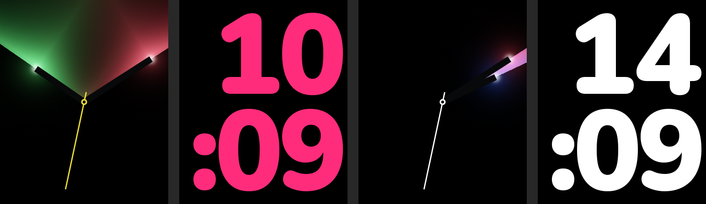

# aplwatch

Smartwatch-style faces for the **Waveshare ESP32-S3-Touch-AMOLED-1.8 V2**
(368 x 448 AMOLED), in Eastern time and UTC. **Tap the screen to cycle:**

1. Eastern light fan (green, red and yellow)
2. Eastern digital (pink)
3. UTC light fan (French tricolore: blue, red and white)
4. UTC digital (white)

The choice is saved and survives power cycles.



- **Digital:** huge rounded digits stacked in two lines, hours above
  `:minutes`, right-aligned on black. 24-hour by default (`15` / `:07`).
  Hot pink for Eastern time, white for UTC.
- **Light fan:** dark hour and minute hands with colored light pouring into
  the wedge between them, a white-hot glow at each tip, and a thin seconds
  hand sweeping smoothly from a ring at the center. Eastern time has green
  light from the hour hand, red from the minute hand and a yellow seconds hand.
  UTC has blue, red and white. Everything outside the wedge stays black, which
  is cheap on an AMOLED.

[preview-contact.png](preview-contact.png) shows a 12-hour time, midnight,
the waiting states (dim dashes and a dim center ring), and both light fans at
12:00, 3:40, 6:32 and 8:20. When the hands overlap, the wedge closes and only
the tip glows remain.

## Time

Same approach as Rolex, Breitling and WatchFaceRTC: Wi-Fi with background NTP,
Eastern time with automatic daylight saving, and retries every 30 seconds.
After each sync the board's PCF85063 RTC is set to UTC. At boot, the sketch
restores the time from the RTC if that marker is set by this sketch or by
WaveshareHelloWorld. That means it shows the right time immediately, even
offline. The UTC faces read the same system clock without the timezone.

`WiFiCredentials.h` was copied from Rolex. It's ignored by git; edit it if your
network changes. Timezone, NTP servers, 12/24-hour mode, brightness and the
refresh intervals are in `AplConfig.h`.

## Build and upload

```powershell
.\Build.ps1
.\Build.ps1 -Upload -Port COM5
```

The board settings are the same as the other S3 projects: ESP32-S3, 16 MB
flash, OPI PSRAM, USB CDC, V2 panel, COM5. `-Revision original` selects the
SH8601 panel, and `-DryRun` prints the command only. Libraries come from
`..\WaveshareHelloWorld\vendor\<revision>\libraries`: GFX_Library_for_Arduino,
Adafruit_XCA9554, Adafruit_BusIO, Mylibrary and SensorLib. No LVGL is used;
the faces draw their own pixels. The script compiles with `-O2`.

Serial at 115200 baud: `f` moves to the next face. The log reports each touch
(position, duration, travel), each switch and its cause, NTP and RTC events,
and light-face render times.

## How it works

- `AplFaces.h` renders the faces in software into RGB565 buffers, with
  anti-aliased edges and ordered dithering to hide banding. It doesn't use any
  display library, so `preview.py` runs the same code on a PC.
- **Digital:** digits are 8-bit alpha masks in `DigitFont.h`, baked by
  `prepare_assets.py` from Nunito Black (weight 900, 180 px). The face is
  redrawn only when the minute changes.
- **Light fan:** each pixel's light is computed from its distance to the
  hands' edges, its position along them, and the tip glows. Rendering the
  whole screen takes about 0.9-1.1 s on the ESP32-S3. A task on core 0
  re-renders it every 10 seconds into a back buffer. Core 1 keeps sweeping
  the seconds hand at about 30 fps, pushing only the small rectangle around
  the old and new hand positions. While a digital face is shown, the fan
  keeps rendering for the next analog face's zone, so the next tap is
  instant. After quick taps, the previous face stays up for up to a second
  until the fan for the right zone is ready.
- **Switching:** a tap counts as soon as the finger lands. The next digital
  face is kept drawn while an analog face is up, and a fan goes straight to
  the screen with its seconds hand one frame later. Every switch is a single
  full-screen push: 46 ms at the panel's 40 MHz QSPI clock. The serial log
  reports each switch's time.
- `fastExp` replaces `expf`, cutting the light render from 2.5 s. That and
  avoiding divisions and `lroundf` brought it to about 0.9 s. `preview.py`
  checks `fastExp` against `expf` to within 2e-4.
- The board needs four full-screen buffers (330 KB each): the digital face,
  the light face shown, the light face being rendered, and a scratch buffer.
  They all live in PSRAM.

## Previews and checks

```powershell
python preview.py
python prepare_assets.py   # only after changing the font or digit size
```

The scripts need g++ (MSYS2 MinGW) and Pillow. `preview.py` compiles
`AplFaces.h` and renders the previews. It also checks that:

- every one of the 1440 times fits on screen,
- the seconds hand never draws outside its even-aligned redraw rectangle,
- drawing into a small window matches drawing the full screen,
- `fastExp` matches `expf`.

If Windows Controlled Folder Access blocks Python from creating files under
Documents, pass `--output-dir` with a folder outside Documents and copy the
results in.

## Assets

The digit font is Nunito (Copyright 2014 The Nunito Project Authors), under
the SIL Open Font License 1.1: [assets/OFL.txt](assets/OFL.txt). The variable
TTF is [assets/Nunito-wght.ttf](assets/Nunito-wght.ttf), from
<https://github.com/google/fonts/tree/main/ofl/nunito>.
