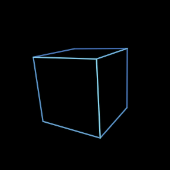

# Spinning wireframe cube

A perspective-projected 3D cube for the **Waveshare ESP32-S3-Touch-AMOLED-1.8 V2**
(368 x 448 CO5300 panel), matching the S3 sibling project. All twelve edges remain
visible, with dim blue rear edges and brighter icy-cyan near edges on black.
Continuous rotation around three axes keeps the motion varied.
The display cycles every 20 seconds through the blue cube, a gold tetrahedron,
magenta octahedron, green dodecahedron, and pink icosahedron, then repeats.
A centered white label below the animation shows the current shape's name.
Rotation continues across each switch. All five shapes share the same vertex
radius and antialiased glow renderer. Each shape's geometry and color live in
its own `*Shape.h` file; `ShapeTypes.h` defines their shared mesh format.

## Build and upload

```powershell
.\Build.ps1
.\Build.ps1 -Upload -Port COM6
```

The default is ESP32-S3, 16 MB flash, OPI PSRAM and USB CDC enabled. COM6 is the
currently connected USB serial adapter; override `-Port` if it changes. Upload
replaces the board's existing sketch. Close Serial Monitor before uploading.
Use `-Revision original` for the original SH8601 panel instead of V2.
`-DryRun` prints the command without compiling or flashing.

Dependencies are reused from `..\WaveshareHelloWorld\vendor\v2\libraries` (or
`original`), preserving the existing vendor sources and licenses. This project
therefore needs that sibling folder. No downloads, network, touch, audio, or
external artwork are required. V2 uses the sibling's XCA9554 reset sequence and
QSPI pins: CS 12, clock 11, data 4/5/6/7; I2C SDA 15 and SCL 14.

## Smooth graphics

- Analytic subpixel edge coverage, rounded ends and a subtle halo avoid jagged lines.
- A complete RGB565 framebuffer is rendered before presentation: no visible clear
  followed by individual edge drawing and no accumulation of trails.
- Only the centered 288 x 288 animation region is transferred over QSPI; the rest
  of the display stays black. The cube fits inside that region at every angle.
- Rotation uses elapsed time, not frame count, and angles wrap indefinitely.
- Frame pacing targets 60 FPS; actual performance is reported over serial, not assumed.

`CubeConfig.h` controls frame rate, brightness, camera distance, focal length and
axis speeds (radians/second). The framebuffer uses 165,888 bytes, preferring
PSRAM with an internal-RAM fallback. Allocation/display failures stop safely.
The transfer is synchronous, so one framebuffer suffices without racing DMA.
Changing projection/region settings should be followed by the bounds tests.
This is buffered drawing, not panel-vsync synchronization; panel tearing is
hardware-dependent and needs visual confirmation on the device.
`SHAPE_SECONDS` in `CubeConfig.h` controls the time spent on each shape.

## Tests and preview

```powershell
.\Test.ps1
.\Test.ps1 -Preview
```

Uses the installed `g++` to exercise the actual portable animation header with
warnings treated as errors. Checks cover fractional antialias intensity, motion,
framebuffer guard values, projected bounds, preservation of 3D vertex radius,
ten minutes of updates and deterministic replay. Temporary test files are removed.
`-Preview` regenerates `preview.png` from the same RGB565 renderer.



Serial Monitor uses **921600 baud**. A status line every five seconds reports
measured FPS, render/transfer time and free heap. Startup reports framebuffer
size, detected PSRAM and target FPS. No waiting for a serial connection blocks animation.

## Verification

The ESP32-S3 V2 build passed: 396,316 bytes flash and 24,744 bytes static RAM,
plus the runtime framebuffer. Native tests passed with `-Wall -Wextra -Werror`,
and the generated preview was visually inspected. VS Code reported no errors.
An upload to COM6 was attempted, but Windows denied access because the port was
busy. Deployment, measured device FPS and physical visual smoothness therefore
remain unverified; close the program holding COM6 and run the upload command above.
